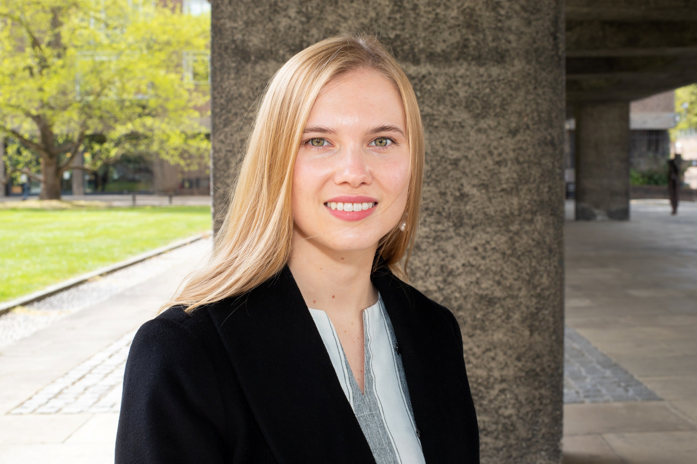

## About Me

I am a <a href="https://www.joh.cam.ac.uk/research/academics/fellows/dr-holli-sargeant">Research Fellow in Law at St John’s College, University of Cambridge</a>. I completed my PhD in the <a href="https://www.law.cam.ac.uk/">Faculty of Law, University of Cambridge</a>, supervised by <a href="https://www.law.cam.ac.uk/people/academic/f-steffek/6136">Felix Steffek</a> and <a href="https://www.law.cam.ac.uk/people/academic/l-vinx/78311">Lars Vinx</a>, and advised by <a href="https://mansmeg.github.io/">Måns Magnusson</a> and <a href="https://mlg.eng.cam.ac.uk/adrian/">Adrian Weller</a>. My thesis, <a href="https://doi.org/10.17863/CAM.115485"><em>Machine Learning in Consumer Credit: Legal, Economic, Ethical &amp; Policy Implications</em></a>, examined the interaction between AI systems and consumer finance. I completed part of my research as a <a href="https://www.law.cam.ac.uk/faculty-international-academic-links">doctoral exchange student</a> at Harvard Law School and an <a href="https://cyber.harvard.edu/people/holli-sargeant">affiliate</a> at Harvard University’s Berkman Klein Center for Internet &amp; Society. My doctoral research was funded by a <a href="https://www.johnmonash.com/scholar/holli-sargeant/">General Sir John Monash Scholarship</a>.

## Research Interests

My research focuses on the intersection of **law and artificial intelligence**. I study how **algorithmic systems deployed in high-stakes decision making** impact fairness, discrimination, and accountability, and how legal frameworks can adapt to ensure responsible and ethical AI governance. I also explore **AI's role in legal research and access to justice**, including projects evaluating biases in legal datasets, AI-assisted legal practice, and judicial decision-making. My work is interdisciplinary and integrates doctrinal and comparative legal analysis, law and economics, normative theory, and statistical and machine learning methods. More on my [research](/research/).

## News

- **July 2026:** My PhD thesis was awarded the [Yorke Prize](https://www.law.cam.ac.uk/press/news/2026/07/research-students-win-yorke-prizes-excellence) by the Cambridge Faculty of Law.
- **July 2026:** Published [*Artificial Intelligence &amp; Justice*](https://doi.org/10.17863/CAM.132259) with the Nuffield Foundation.
- **May 2026:** [*From Estimation to Discrimination*](https://doi.org/10.1111/1468-2230.70045) published in the *Modern Law Review*.
- **November 2025:** *Detecting Legal Citations in United Kingdom Court Judgments* received an [EMNLP Senior Area Chair Highlight Award](https://2025.emnlp.org/program/awards/).
- **October 2025:** Appointed [Research Fellow in Law at St John’s College, Cambridge](https://www.joh.cam.ac.uk/about-us/news-and-research/academics-in-the-arts-humanities-and-sciences-join-st-johns-fellowship).

## Selected Papers

<a class="pub-title" href="https://doi.org/10.1111/1468-2230.70045">From Estimation to Discrimination: Algorithmic Bias, Predictive Uncertainty, and Anti-Discrimination Law</a> 
<b>Holli Sargeant</b> 
The Modern Law Review (2026) 

<a class="pub-title" href="https://doi.org/10.1016/j.clsr.2025.106247">Mind the Gap: Securing Algorithmic Explainability for Credit Decisions Beyond the UK GDPR</a> 
<b>Holli Sargeant</b> 
Computer Law &amp; Security Review (2026) 

<a class="pub-title" href="https://doi.org/10.1145/3805689.3806763">Prompt Governance? On Governing Technologies Governed by Natural Language</a> 
Anna Neumann, <b>Holli Sargeant</b>, Jatinder Singh 
FAccT (2026) 

<a class="pub-title" href="https://doi.org/10.18653/v1/2025.emnlp-main.1361">Detecting Legal Citations in United Kingdom Court Judgments</a> 
<b>Holli Sargeant</b>, Andreas Östling, Måns Magnusson 
EMNLP (2025) · Senior Area Chair Highlight 

<a class="pub-title" href="https://doi.org/10.1145/3715275.3732015">Formalising Anti-Discrimination Law in Automated Decision Systems</a> 
<b>Holli Sargeant</b>, Måns Magnusson 
FAccT (2025) 

<a class="pub-title" href="https://doi.org/10.1145/3715275.3732016">Classifying Hate: Legal and Ethical Evaluations of ML-Assisted Hate Crime Classification and Estimation in Sweden</a> 
<b>Holli Sargeant</b>, Hannes Waldetoft, Måns Magnusson 
FAccT (2025) 

[Full list of publications](/publications/)
