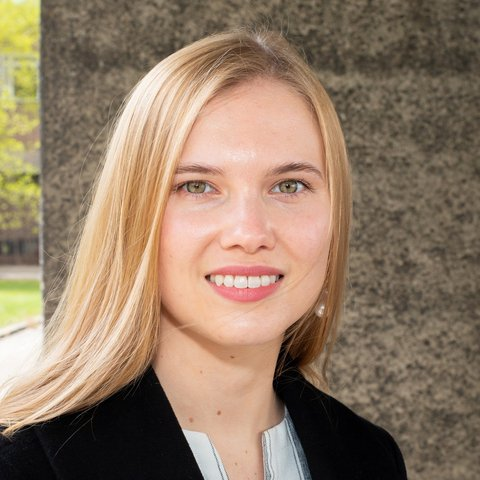

## About Me

I am a <a href="https://www.joh.cam.ac.uk/research/academics/fellows/dr-holli-sargeant">Research Fellow in Law at St John's College, University of Cambridge</a> (Junior Research Fellowship, 2025–2029). I study how law can hold algorithmic decision systems to account, in consumer markets and in the justice system, and how computational evidence about the law can support that work.

I completed my PhD in the <a href="https://www.law.cam.ac.uk/">Faculty of Law, University of Cambridge</a>, supervised by <a href="https://www.law.cam.ac.uk/people/academic/f-steffek/6136">Felix Steffek</a> and <a href="https://www.law.cam.ac.uk/people/academic/l-vinx/78311">Lars Vinx</a> and advised by <a href="https://mansmeg.github.io/">Måns Magnusson</a> and <a href="https://mlg.eng.cam.ac.uk/adrian/">Adrian Weller</a>. My thesis, <a href="https://doi.org/10.17863/CAM.115485"><em>Machine Learning in Consumer Credit: Legal, Economic, Ethical &amp; Policy Implications</em></a>, received the Faculty's Yorke Prize in 2026. During the PhD I was a doctoral exchange student and later a visiting researcher at Harvard Law School, and I am an <a href="https://cyber.harvard.edu/people/holli-sargeant">affiliate</a> of the Berkman Klein Center for Internet &amp; Society. My doctoral research was funded by a <a href="https://www.johnmonash.com/scholar/holli-sargeant/">General Sir John Monash Scholarship</a>.

Before my PhD I was a solicitor at Herbert Smith Freehills and was seconded to the Australian Human Rights Commission, where I co-authored its Human Rights and Technology reports.

<a href="mailto:hs775@cam.ac.uk">Email</a> ·
<a href="https://scholar.google.com/citations?user=eKUDjkwAAAAJ">Google Scholar</a> ·
<a href="https://orcid.org/0000-0003-3482-7789">ORCID</a> ·
<a href="https://bsky.app/profile/hollisargeant.bsky.social">Bluesky</a> ·
<a href="https://www.linkedin.com/in/hollisargeant/">LinkedIn</a> ·
<a href="https://github.com/hollisargeant">GitHub</a>

## Research Interests

My work is interdisciplinary. It combines doctrinal and comparative legal analysis with law and economics, normative theory, and statistical and machine learning methods. It has three connected strands:

- **Rights in algorithmic decisions.** How anti-discrimination and data protection law apply to machine learning systems that make high-stakes decisions, such as credit scoring, and what those laws should require of their design.
- **AI in the justice system.** How AI tools are changing courts, legal advice and the legal profession, and how to evaluate them against the interests of the people the justice system serves.
- **Law as data.** Building datasets and methods for computational legal research, including the <a href="https://www.cst.cam.ac.uk/research/srg/projects/law">Cambridge Law Corpus</a> of UK case law.

More detail is on the [Research](/research/) page.

## News

| | |
|---|---|
| Oct 2026 | Presented the findings of the Nuffield Foundation report *Artificial Intelligence &amp; Justice* to about 220 civil servants at the AI Insights seminar run by the Open Innovation Team and the Policy Insights Unit. |
| Oct 2026 | Spoke on *Law as Data: Extracting Computational Insights from Legal Text* at the SweCSS Symposium, Söderköping. |
| Jul 2026 | My PhD thesis received the [Yorke Prize](https://www.law.cam.ac.uk/press/news/2026/07/research-students-win-yorke-prizes-excellence) from the Cambridge Faculty of Law. |
| Jul 2026 | Published [*Artificial Intelligence &amp; Justice*](https://doi.org/10.17863/CAM.132259) for the Nuffield Foundation. Of 45 AI tools identified in civil and family justice and advice services, only seven have any public evaluation. [[Press release]](https://www.nuffieldfoundation.org/news/ai-rollout-justice-system-outpacing-scrutiny-new-report) [[Policy brief]](https://www.nuffieldfoundation.org/publications/artificial-intelligence-justice) |
| Jun 2026 | *Prompt Governance?* (with Anna Neumann and Jatinder Singh) published at ACM FAccT 2026. |
| May 2026 | [*From Estimation to Discrimination*](https://doi.org/10.1111/1468-2230.70045) published in the *Modern Law Review*. |
| Nov 2025 | *Detecting Legal Citations in United Kingdom Court Judgments* received an EMNLP 2025 [Senior Area Chair Highlight](https://2025.emnlp.org/program/awards/) award (top 2.5% of accepted papers). |
| Oct 2025 | Started as Research Fellow in Law at [St John's College, Cambridge](https://www.joh.cam.ac.uk/about-us/news-and-research/academics-in-the-arts-humanities-and-sciences-join-st-johns-fellowship). OECD policy paper on [access to justice for SMEs](https://doi.org/10.1787/1791ca66-en) published with Felix Steffek. |

## Selected Papers

<a class="title" href="https://doi.org/10.1111/1468-2230.70045">From Estimation to Discrimination: Algorithmic Bias, Predictive Uncertainty, and Anti-Discrimination Law</a> 
<u>Holli Sargeant</u> 
<em>The Modern Law Review</em>, 2026

<a class="title" href="https://doi.org/10.1016/j.clsr.2025.106247">Mind the Gap: Securing Algorithmic Explainability for Credit Decisions Beyond the UK GDPR</a> 
<u>Holli Sargeant</u> 
<em>Computer Law &amp; Security Review</em>, 2026

<a class="title" href="https://doi.org/10.17863/CAM.132259">Artificial Intelligence &amp; Justice</a> 
<u>Holli Sargeant</u> 
<em>Nuffield Foundation, Public Right to Justice programme</em>, 2026

<a class="title" href="https://doi.org/10.1145/3805689.3806763">Prompt Governance? On Governing Technologies Governed by Natural Language</a> 
Anna Neumann, <u>Holli Sargeant</u>, Jatinder Singh 
<em>ACM FAccT</em>, 2026

<a class="title" href="https://doi.org/10.18653/v1/2025.emnlp-main.1361">Detecting Legal Citations in United Kingdom Court Judgments</a> 
<u>Holli Sargeant</u>, Andreas Östling, Måns Magnusson 
<em>EMNLP</em>, 2025 · Senior Area Chair Highlight

<a class="title" href="https://doi.org/10.1145/3715275.3732015">Formalising Anti-Discrimination Law in Automated Decision Systems</a> 
<u>Holli Sargeant</u>, Måns Magnusson 
<em>ACM FAccT</em>, 2025

<a class="title" href="https://dl.acm.org/doi/10.5555/3666122.3667915">The Cambridge Law Corpus: A Dataset for Legal AI Research</a> 
Andreas Östling, <u>Holli Sargeant</u>, Helena Xie, Ludwig Bull, Alex Terenin, Leif Jonsson, Måns Magnusson, Felix Steffek 
<em>NeurIPS Datasets and Benchmarks</em>, 2023

[Full list of publications →](/publications/)

## Recent Talks

| | |
|---|---|
| Oct 2026 | *AI in the Justice System: Evidence from the Nuffield Foundation Report*. AI Insights seminar for UK civil servants, Open Innovation Team and Policy Insights Unit |
| Oct 2026 | *Law as Data: Extracting Computational Insights from Legal Text*. SweCSS Symposium, Söderköping |
| Oct 2026 | Guest lecture, Digital Technology in Legal Practice (LLM). University of Bristol |
| May 2026 | *Legal AI Alignment*. AI Seminar Series, University of Bergen [[Recording]](https://www.youtube.com/watch?v=vI_X9cvDIU4&t=8885s) |
| Apr 2026 | *Encoding Equality: The Incompatibility of Algorithmic Logic and Substantive Law*. New Technology, AI &amp; Equality Workshop, University of Southampton |

[All talks →](/talks/)

## Policy Engagement

My research informs work by public bodies and civil society organisations on AI and justice:

- **Nuffield Foundation** (2025–2026): author of [*Artificial Intelligence &amp; Justice*](https://doi.org/10.17863/CAM.132259), an evidence review for the Public Right to Justice programme.
- **OECD** (2025): co-author with Felix Steffek of [*Supporting Businesses Through Better Justice Systems*](https://doi.org/10.1787/1791ca66-en), OECD Public Governance Policy Paper No. 79.
- **JUSTICE** (2024–2025): consultant and contributor to [*AI in our Justice System*](https://files.justice.org.uk/wp-content/uploads/2025/01/29201845/AI-in-our-Justice-System-final-report.pdf).
- **Australian Human Rights Commission** (2020–2021): co-author of the [*Human Rights and Technology*](https://apo.org.au/node/312514) final report and the technical paper on [algorithmic bias](https://apo.org.au/node/309692).
- **OSCE** (2021): co-author of [*Spotlight on Artificial Intelligence and Freedom of Expression*](https://www.osce.org/representative-on-freedom-of-media/510332).

## Teaching

**2026** · Guest lecture, Digital Technology in Legal Practice (LLM), University of Bristol 
**2021–2026** · Guest lecturer, Master of Statistics, Uppsala University 
**2025** · *AI and the Future Legal Profession* lecture series, University of Cambridge 
**2023** · Thesis supervisor, MSt in AI, Ethics &amp; Society, University of Cambridge 
**2021–2023** · Company Law supervisor, Law Tripos, University of Cambridge 
**2021–2023** · Thesis supervisor and external examiner, Master of Laws, University of Edinburgh 
**2022** · Director of Studies in Law, Newnham College, Cambridge 
**2022** · Teaching Fellow, *ESG: Corporate Ethics in the 21st Century*, Harvard Law School

## Service

- **Reviewing (journals):** AI and Ethics; Artificial Intelligence and Law; Behavioural Public Policy; Cambridge Forum on AI: Law and Governance; Cambridge Yearbook of European Legal Studies; Computer Law &amp; Security Review; Data &amp; Policy
- **Reviewing (conferences and grants):** NeurIPS; ACM FAccT; ICML AI4Law Workshop; US National Science Foundation
- **Admissions:** Law Tripos admissions, St John's College (2025) and Newnham College (2021, 2024)

## Awards

**2026** · Yorke Prize, Faculty of Law, University of Cambridge 
**2025** · Senior Area Chair Highlight, EMNLP 
**2024** · 100 Brilliant Women in AI Ethics 
**2023** · Greta Burkill Prize, Peterhouse, Cambridge 
**2022** · Best Doctoral Paper, Society of Legal Scholars 
**2021–2024** · General Sir John Monash Scholarship
